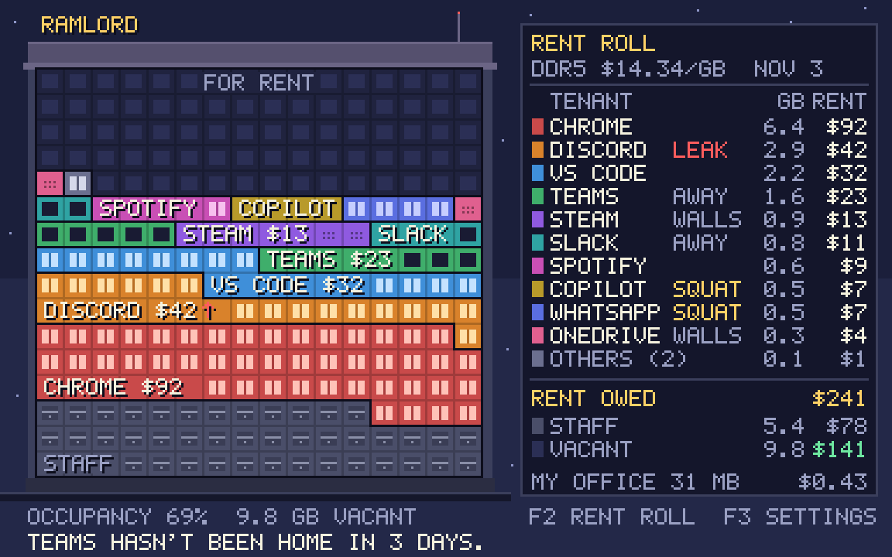

# RAMlord

Your apps have been living rent-free in your RAM.

RAMlord is a small Windows desktop app that draws your PC's memory as a
pixel-art apartment tower. Every running app is a tenant, sized by the memory
it holds and billed at the current street price of RAM. It is free, needs no
account, sends no telemetry and asks for no admin rights.



**Status:** early development. On Windows, `ramlord` shows your real apps
in the tower, updating every 2 seconds, tags the ones you forgot (AWAY,
WALLS, SQUAT, LEAK) and has the landlord say something about it. Click a
tenant (or use Up, Down and Enter) for its details card; from there you
can mark it Family or evict it. Eviction always asks first, then asks the
app to close like its own close button would, and only forces it out if
you say so. Prices for your memory type, settings and the tray come next. See
[SPEC.md](SPEC.md) for the full design and the milestones.

## Build

```bash
cargo test --workspace
cargo run -p ramlord -- --building fixtures/sample-building.json --render tower.png --card rent-roll.png
```

On Windows, `cargo build --release` produces `target/release/ramlord.exe`.
`ramlord --dump my-pc.json` writes what RAMlord sees (no window titles,
command lines or user names; your profile folder becomes `%USERPROFILE%`),
and `ramlord --self-test report.json` checks RAMlord's own budgets.

## License

GPL-3.0-only. See [LICENSE](LICENSE).
