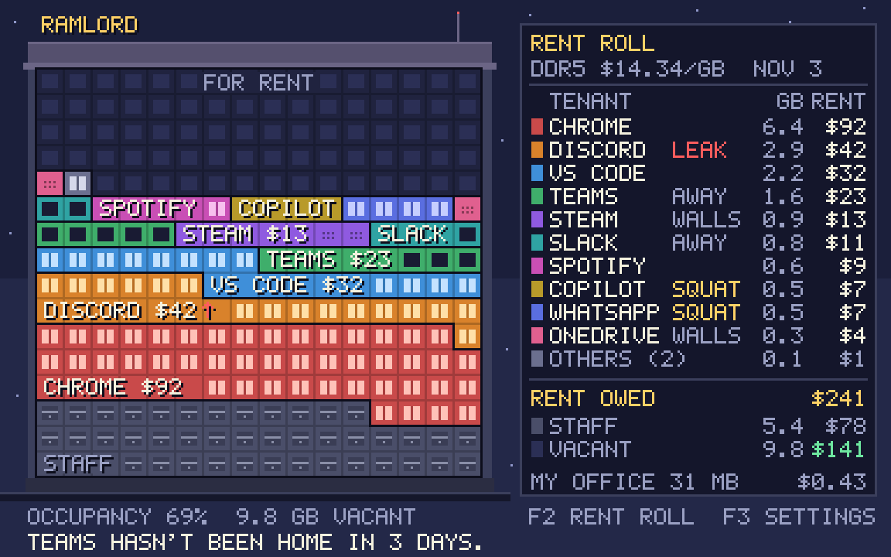
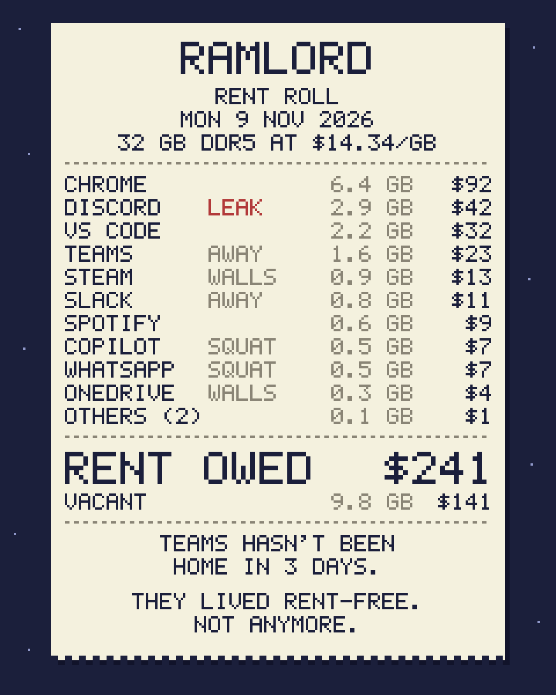
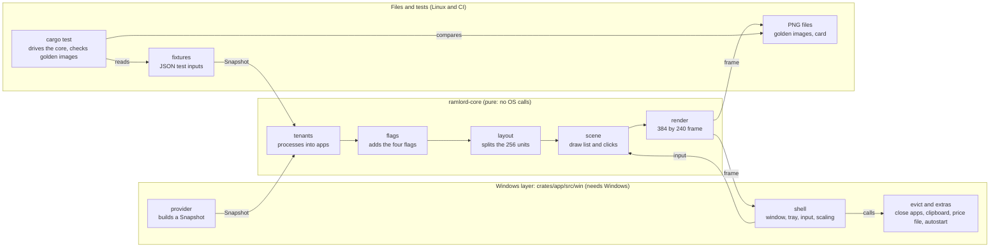

# RAMlord: build spec and first prompt

Spec as of 10 November 2026. Exported from the doc "RAMlord: build spec and first prompt".

## Start here

The spec and its reference files are in [stef-al/ramlord](https://github.com/stef-al/ramlord). Paste the first prompt (last section) into a Claude Code cloud session on that repo. Claude builds the first two milestones, pushes a branch and stops for your review.

1. Merge the pull request [Add spec and reference files](https://github.com/stef-al/ramlord/pull/1), if it is still open. It adds `SPEC.md`, which is this doc as Markdown, the reference files and the prototype's working files.
2. Open [claude.ai/code](https://claude.ai/code), connect GitHub, pick the repo and keep the Default environment. Leave the permission mode on Auto or Accept edits; Plan waits for approval before any edit.
3. Paste the first prompt. When Claude reports back, review the diff and select **Create PR**.
4. In the Changes card, open the menu next to the pull request title and turn on **Auto-fix**, so Claude reacts to failing checks on its own. Auto-fix needs the Claude GitHub App installed on the repo.

These choices are already made in the spec. Change any of them here before you start.

| Decision | Choice | Reason |
| --- | --- | --- |
| Name | RAMlord (working title); repo and exe are `ramlord` | Says the joke in one word |
| Platform | Windows 10 and 11, x64, no admin rights | Where the pain is; no elevation keeps it safe |
| Language | Rust, native, no web view | An app that shames memory hogs has to be small itself |
| License | GPL-3.0, as chosen when the repo was created | A tool that closes other programs must be inspectable |
| Price and data | Free, no account, no telemetry | Trust first; cosmetics can come later |
| Money | US dollars per GB by default; any price and symbol can be typed in | Prices differ by country and by memory type |
| Scope of version 1 | Memory only | Disk "storage units" are a later release |

## What it is

RAMlord is a small Windows desktop app that draws your PC's memory as a pixel-art apartment tower. Every running app is a tenant, sized by the memory it holds and billed at the current street price of RAM.

- **Who it is for:** people on 8 to 32 GB PCs who cannot cheaply add memory and want to see what is using it without learning Task Manager.
- **The joke:** your apps have been living rent-free in your RAM, and you are the landlord.
- **The use:** one honest number per app, a nudge about the ones you forgot, and a safe way to close them.

Every term in the app maps to one real thing.

| In the app | What it really is |
| --- | --- |
| Building | Installed physical RAM |
| Unit | 1/256 of installed RAM (128 MB on a 32 GB PC) |
| Tenant | One app: a group of related processes |
| Rent | The tenant's private memory in GB, times the price per GB |
| Staff | Windows itself, drivers and shared memory |
| Vacant | Memory Windows reports as available |
| Not home | A tenant with a window that has gone 4 hours without focus |
| In the walls | A tenant with no visible window |
| Squatter | A tenant that starts with Windows and has not been opened since boot |
| Leaker | A tenant whose memory keeps growing |
| Evict | Close the app |

Six principles settle arguments later.

1. **Never lie about memory.** There is no boost, clean or optimize button. Closing an app is the only thing that frees memory, and the app says so.
2. **Calm when things are fine.** When more than half the building is vacant, the landlord says nobody needs evicting.
3. **Be the smallest tenant.** Budget: under 40 MB of private memory, under 1% average CPU, exe under 5 MB.
4. **Nothing leaves the PC.** The only network request fetches a small price file. No account, no telemetry.
5. **No admin rights, no system changes.** It reads, it closes the apps you choose, and it opens Windows' own settings pages for the rest.
6. **Every screen is worth a screenshot.** The picture has to be funny and readable without explanation.

Not in version 1: disk cleanup, registry edits, switching startup apps on or off inside the app, toast notifications, auto-update, and releases for macOS or Linux. The Linux build exists only so the code can be developed and tested in the cloud.

## The tower

The window is one 384 by 240 pixel canvas scaled by a whole number: the tower on the left, the rent roll on the right, two status lines below.



This reference render comes from the Python prototype. Its repo copy is `docs/reference/tower.png`.

**Canvas.** Draw into a CPU framebuffer and scale it 2 to 5 times with nearest-neighbor; 3 times gives 1152 by 720. Pick the largest scale that fits 70% of the screen's work area. All text uses one 5 by 7 pixel bitmap font with a 6 pixel advance, uppercase only.

| Region | x, y, width, height | Holds |
| --- | --- | --- |
| Roof | 12, 6, 200, 24 | Sign and antenna |
| Unit grid | 16, 30, 192, 176 | 16 columns by 16 floors of 12 by 11 pixel cells |
| Street | 0, 212, 220, 4 | Ground line |
| Status lines | 12, 219 and 12, 230 | Occupancy and two key hints, then the landlord's remark |
| Rent roll | 224, 10, 154, 204 | Price line, column heads, up to 10 tenants, Others, total, Staff, Vacant, own footprint |

**Dividing the building.** This is the rule the tests pin down. Use integer bytes throughout.

1. The building has 256 units. An entry's whole units are `bytes * 256 / capacity`; its remainder is `bytes * 256 % capacity`.
2. Named tenants are the 40 largest tenants that hold at least half a unit. Everyone else merges into one entry, Others.
3. Fill order is Staff, named tenants by rent descending (ties by name), Others, Vacant.
4. Give every entry its whole units. Hand out the leftover units one each, largest remainder first. Ties go to more bytes, then to fill order.
5. An entry with memory but no unit takes one from the entry holding the most. Vacant may be zero.
6. Fill the grid from the ground floor up, left to right, in fill order.

To stop flicker, feed the layout rent smoothed over 10 seconds. Two neighbors swap places only after the lower one has led by 5% for 30 seconds. The rent roll always shows current numbers.

**Drawing units.** A 1 pixel dark outline separates different owners.

| Owner | Cell |
| --- | --- |
| Tenant | Wall in the tenant's hue, lit two-pane window |
| Tenant, not home | Same wall, dark window |
| Tenant, in the walls | Same wall, no window, six vent dots |
| Others | Gray-violet wall, lit window |
| Staff | Gray wall, pipe motif |
| Vacant | Dark wall, dark window |

**Labels.** On a tenant's widest floor segment, a windowless strip carries `NAME $RENT` if it fits, else `NAME` if it fits, else nothing. A leaker's label ends with a red up arrow. The widest vacant segment shows `FOR RENT` when it is at least 6 units wide.

**Hues.** A tenant keeps its hue for life, saved in state. New tenants are served in fill order. Each gets the hue least used among current named tenants, ties in palette order.

```text
sky #1b1f3b   sky_low #232848   star #8f97c9   outline #0d0e1c
building #3b3f5c   roof #55506e   roof_edge #6b6585   foundation #2b2d42
street #15172b
vacant_wall #20233f   vacant_window #2b2f55   dark_window #191b33
staff_wall #4a4e69   staff_detail #8a8fa8   staff_panel #3a3d55
others_wall #6b6f8f   others_window #d5d8ea
text #f4f1de   text_dim #9aa0c3   gold #ffd166   alert #ff5d5d   good #6ee7a0
panel #14162b   panel_line #3b3f5c

rent roll card:
paper #f4f1de   ink #1b1f3b   paper_faint #8a8576   paper_alert #b23a3a
paper_shadow #11132a

tenant hues, wall then window:
 1 #c94a4a #ffc2b8    2 #d9822b #ffe0a8    3 #3f8fd9 #c4e2ff
 4 #3fae6b #bff2d2    5 #8f5ae0 #dcc6ff    6 #2fa3a3 #b4f0ec
 7 #c94fb5 #f7c0ee    8 #b89a2a #fff1a8    9 #5a6ee0 #c6ceff
10 #e0608f #ffc6d8   11 #7fae3a #dff2b0   12 #b08a5a #f0d8b6
```

**Rent roll.** The panel lists the 10 largest tenants, largest first.

- Each row shows a hue swatch, the short name (8 characters), one tag, GB to one decimal and rent in whole dollars, halves rounded up.
- Tag priority is LEAK, SQUAT, AWAY, WALLS.
- The `OTHERS (n)` row sums everyone not listed, including named tenants beyond the tenth; n is their count.
- `RENT OWED` is the sum of the amounts shown above it, so the roll always adds up.
- Below the total come Staff, Vacant and `MY OFFICE`: RAMlord's own memory, with its rent in cents.

**Input.** Click a unit or a rent roll row to select a tenant; the details card then replaces the rent roll. Keys: Up and Down select, Enter opens details, Delete evicts, Esc goes back, F2 makes the rent roll card and F3 opens settings. The first status line ends with `F2 RENT ROLL  F3 SETTINGS`, and both hints can be clicked.

**Sample building.** This is the demo fixture, `fixtures/sample-building.json`, and the first test vector: 32 GB of DDR5 at $14.34 per GB, with 10,035 MB vacant. Rent owed is $241 and occupancy is 69%. Sizes are binary, as in Windows: 1 MB is 2^20 bytes.

| Tenant | MB | Processes | State | Units | Rent |
| --- | --- | --- | --- | --- | --- |
| Staff | 5,560 |  |  | 44 | $78 |
| Chrome | 6,554 | 47 |  | 51 | $92 |
| Discord | 2,970 | 6 | Leaker | 23 | $42 |
| VS Code | 2,253 | 14 |  | 18 | $32 |
| Teams | 1,638 | 9 | Not home | 13 | $23 |
| Steam | 922 | 8 | In the walls | 7 | $13 |
| Slack | 819 | 5 | Not home | 6 | $11 |
| Spotify | 614 | 6 |  | 5 | $9 |
| Copilot | 512 | 4 | Squatter | 4 | $7 |
| WhatsApp | 512 | 7 | Squatter | 4 | $7 |
| OneDrive | 307 | 2 | In the walls | 2 | $4 |
| Others: Terminal 41, Notepad 31 | 72 | 4 |  | 1 | $1 |
| Vacant | 10,035 |  |  | 78 | $141 |

## Tenants and rent

A tenant is one app, and its rent is the private memory it holds in RAM right now. That is the same number Task Manager shows in its Memory column.

**What is measured.**

| Number | Source on Windows | Used for |
| --- | --- | --- |
| Rent bytes | `PrivateWorkingSetSize` from `GetProcessMemoryInfo` with `PROCESS_MEMORY_COUNTERS_EX2`, summed over the tenant's processes | Units and rent |
| Lease bytes | `PagefileUsage` (commit charge) from the same call | Details card only |
| Capacity | `GetPhysicallyInstalledSystemMemory`. If it fails or reports less than `PhysicalTotal` from `GetPerformanceInfo`, use `PhysicalTotal` | Building size |
| Vacant | `PhysicalAvailable` from `GetPerformanceInfo`, times `PageSize` | Vacancy |
| Commit used and limit | `CommitTotal` and `CommitLimit` from the same call | The "building full" alert |
| Staff bytes | Capacity minus vacant minus all tenants' rent | Staff units |

- `PrivateWorkingSetSize` needs Windows 10 22H2 or Windows 11 22H2 with the September 2023 update ([Microsoft](https://learn.microsoft.com/en-us/windows/win32/api/psapi/ns-psapi-process_memory_counters_ex2)). When the call fails, or every process reports 0 there, use `WorkingSetSize`, set `rent_is_estimate` and prefix amounts with `~`. Wine behaves this way.
- Task Manager's Memory column is the private working set, and its Commit size column is what this spec calls the lease ([Pavel Yosifovich](https://scorpiosoftware.net/2023/04/12/memory-information-in-task-manager/)).
- Installed memory includes what the hardware reserves, so that part counts as Staff. If rent plus vacant ever exceeds capacity, Staff is zero and Vacant shrinks until the three sum to capacity.
- Rent in money is bytes divided by 2^30, times the price per GB. Show whole dollars, and cents under $1.
- RAMlord's own process is never a tenant. It has its own line in the rent roll and its memory falls into Staff.

**From processes to tenants.** The rules read three lists from `rules/windows.toml`, so a wrong bill can be fixed without touching code.

1. **Staff.** A process is Staff if it cannot be opened with `PROCESS_QUERY_LIMITED_INFORMATION`, runs in session 0, or has an image name in `staff`. A process under the Windows directory is also Staff when it owns no visible window and is not in `launchers`.
2. **Root.** From each remaining process, walk up the parent chain while the parent is alive, older than the child, not Staff and not in `launchers`. The last process reached is the root.
3. **Tenant.** All processes whose roots share one image path form one tenant. Its id is that path in lower case.
4. **Helpers.** The `helpers` map names an owner for helper images. An owner image such as `steam.exe` means "join that tenant if it exists". The owner `parent` means "follow the parent even if it is a launcher, and be Staff if the parent is Staff".

```toml
staff = ["explorer.exe", "dwm.exe", "sihost.exe", "ctfmon.exe", "taskhostw.exe",
  "runtimebroker.exe", "shellexperiencehost.exe", "startmenuexperiencehost.exe",
  "searchhost.exe", "textinputhost.exe", "applicationframehost.exe", "dllhost.exe",
  "backgroundtaskhost.exe", "fontdrvhost.exe", "securityhealthsystray.exe",
  "smartscreen.exe", "lockapp.exe"]

launchers = ["cmd.exe", "powershell.exe", "pwsh.exe", "windowsterminal.exe", "wsl.exe",
  "bash.exe", "steam.exe", "epicgameslauncher.exe", "galaxyclient.exe",
  "battle.net.exe", "eadesktop.exe", "upc.exe", "riotclientservices.exe"]

[helpers]
"msedgewebview2.exe" = "parent"
"crashpad_handler.exe" = "parent"
"conhost.exe" = "parent"
"openconsole.exe" = "parent"
"steamwebhelper.exe" = "steam.exe"
"steamservice.exe" = "steam.exe"
"gameoverlayui.exe" = "steam.exe"

[names]
"chrome.exe" = "Chrome"
"msedge.exe" = "Edge"
"firefox.exe" = "Firefox"
"code.exe" = "VS Code"
"ms-teams.exe" = "Teams"
"discord.exe" = "Discord"
"slack.exe" = "Slack"
"spotify.exe" = "Spotify"
"steam.exe" = "Steam"
"onedrive.exe" = "OneDrive"
"windowsterminal.exe" = "Terminal"
```

These lists are a starting point; grow them from real snapshots. A tenant's name comes from `names`, else from the root image's `FileDescription` without a leading company word, else from the file name. Cut it to 8 characters in the rent roll and 16 in details.

**Flags.** Timing rules count watched time only: seconds when RAMlord was sampling and the tenant was running. Gaps longer than 10 seconds, such as sleep, do not count.

| Flag | Tag | Rule |
| --- | --- | --- |
| Not home | AWAY | Owns a visible window, holds at least 100 MB, and has gone 4 watched hours without focus |
| In the walls | WALLS | Owned no visible window during the last 10 watched minutes |
| Squatter | SQUAT | Started within 10 minutes of sign-in, has never had focus, and 30 watched minutes have passed. Applies only when RAMlord itself started within 10 minutes of sign-in |
| Leaker | LEAK | Holds at least 500 MB and grew at least 50% over the last 60 watched minutes, rising in at least 10 of the 12 five-minute buckets. Clears when rent falls 20% below its peak |
| Family | none | Marked by the user; never flagged and never suggested for eviction |

- Sign-in time is the start time of the oldest process in the user's session.
- Focus: once a second, credit the tenant that owns the foreground window (`GetForegroundWindow`, `GetWindowThreadProcessId`).
- Visible window: every 5 seconds, `EnumWindows` for windows that are visible, not cloaked, not tool windows and larger than zero.
- Store apps: their frame belongs to `ApplicationFrameHost.exe`. For a window of class `ApplicationFrameWindow`, use the child window that belongs to a different process.

## Behaviors

Besides drawing the tower, the app shows a details card, evicts on request, speaks up in a few situations, prices memory and prints a rent roll.

**The details card.** Selecting a tenant swaps the rent roll for its card, in the same 154 by 204 pixel panel.

- Top: the name (16 characters), its flags in words, and rent now in GB and dollars.
- Numbers: lease, peak rent, rent one hour ago, process count, time since it moved in and time since your last visit.
- History: 12 bars, one for each five-minute bucket of the last watched hour.
- Actions: Evict, Family on or off, and Open Startup settings for a squatter. Esc or a click on Back returns to the rent roll.

**Evicting a tenant.** Eviction asks politely first and never happens on its own.

1. Evict is offered on the details card and on the Delete key. Staff, Family and RAMlord itself cannot be evicted.
2. Confirm once: "Close NAME? Unsaved work may be lost if it does not ask first."
3. Polite phase: post `WM_CLOSE` to every visible top-level window of the tenant, then wait up to 5 seconds for its processes to exit.
4. If any remain, say "NAME refuses to leave" and offer Force evict or Leave it. Force evict calls `TerminateProcess` on each remaining process.
5. A tenant in the walls has no window to ask, so it goes straight to the Force evict question.
6. If Windows refuses because the app runs with higher rights, say "NAME has a lawyer. Close it yourself." and stop.
7. Report what the next sample shows, for example "Evicted DISCORD. 2.9 GB vacated." Never promise freed memory in advance.

There is no bulk eviction, no elevation prompt and no automatic eviction.

**The landlord's remark.** One line at a time, highest priority first, each shown for at least 20 seconds. A remark has at most 60 characters, the width of the second status line, and its times are watched time. Remarks appear in the window only: no sounds and no pop-ups in version 1.

| Priority | Situation | Trigger | Example |
| --- | --- | --- | --- |
| 1 | Building full | Vacant under 10% of capacity for 20 seconds, or commit used over 90% of the limit | "We're full. Somebody has to go." The largest tenant outside Family is highlighted |
| 2 | Leak | A tenant gains LEAK | "DISCORD keeps knocking down walls: 0.9 to 2.9 GB in 1 hour." |
| 3 | Squatters | Once per sign-in, when the first tenant gains SQUAT | "3 tenants moved in at boot and you never visited." |
| 4 | Not home | A tenant holding at least 500 MB gains AWAY | "TEAMS hasn't been home in 3 days." |
| 5 | All calm | Vacant over 50% | "Half the building is empty. Nobody needs evicting." |
| 6 | Small talk | Otherwise, a new line every 60 seconds | "CHROME is subletting to 47 processes." |

**Squatters.** Detection is behavioral (see Flags), so it catches every startup mechanism without reading the registry. A squatter's details card offers "Open Startup settings", which launches `ms-settings:startupapps` ([Microsoft](https://learn.microsoft.com/en-us/windows/apps/develop/launch/launch-settings)). RAMlord never switches another app's startup entry itself.

**Prices.**

- `prices.json` in the repo root holds the price per GB for each memory type. The exe embeds a copy and, when online fetching is on, refreshes it at most once a day from the repo's raw file URL.
- Basis: the price per GB of the cheapest common 32 GB (2 x 16 GB) kit at US retail. This is deliberately conservative.
- First values: DDR5 $14.34 and DDR4 $6.53 per GB, from kits at $459 and $209 on 3 November 2026 ([Tom's Hardware](https://tomshardware.com/pc-components/ram/ram-price-index-2026-lowest-price-on-ddr5-and-ddr4-memory-of-all-capacities)). A median index read $19.37 for DDR5 on 9 November ([RAM Prices USA](https://rampricesusa.com/ram-price-trends)).
- Memory type comes from the SMBIOS Memory Device structure (type 17, byte at offset 0x12), read with `GetSystemFirmwareTable('RSMB')`. Codes: 0x18 DDR3, 0x1A DDR4, 0x1E LPDDR4, 0x22 DDR5, 0x23 LPDDR5 ([Microsoft](https://learn.microsoft.com/windows/win32/cimwin32prov/win32-physicalmemory), [dmidecode](https://git.centos.org/rpms/dmidecode/raw/c9-beta/f/SOURCES/0006-dmidedecode-Add-new-memory-device-types-from-SMBIOS-spec-3.4.0.patch)).
- LPDDR uses the matching DDR price and DDR3 uses the DDR4 price, both marked "est.". An unknown type asks the user to choose.
- The user can type a custom price and currency symbol. The price line always shows type, price and date.

```json
{
  "as_of": "2026-11-03",
  "currency": "USD",
  "symbol": "$",
  "basis": "cheapest common 32 GB (2x16) kit, US retail, per GB",
  "per_gb": { "DDR5": 14.34, "DDR4": 6.53 }
}
```

**The rent roll card.** F2 renders a 240 by 300 pixel canvas at 4 times scale, a 960 by 1200 PNG.

- Content, top to bottom: title, date, RAM size with type and price, up to 10 tenants and Others with tag, GB and rent, `RENT OWED` in double-size type, Vacant, the current remark, and the closing line "THEY LIVED RENT-FREE. NOT ANYMORE."
- The remark wraps into balanced lines of at most 30 characters. The closing line is always two lines.
- It saves to `Pictures\RAMlord\rent-roll-YYYYMMDD-HHMMSS.png` and copies the image to the clipboard.
- Privacy: app names, sizes and amounts only. Never window titles, file paths, user names or machine names. A setting replaces names with TENANT 1 to n.



The repo copy of this reference card is `docs/reference/rent-roll.png`.

**Window and tray.**

- The window has a fixed size, the canvas times the scale. It cannot be resized or maximized.
- Closing it hides RAMlord in the tray. Quit is in the tray menu.
- The tray icon is a small tower that fills with occupancy and turns red when the building is full. A left click opens the window; the menu offers Open, Rent roll and Quit.
- Only one copy runs. Starting it again brings the first window forward.

**Settings and state.** F3 swaps the rent roll for this list. Up and Down move, Enter or a click changes the selected row, and a custom price is typed in.

| Setting | Default |
| --- | --- |
| Scale | Automatic, 2 to 5 times |
| Always on top | Off |
| Close button | Hides to the tray; can be set to quit |
| Start with Windows | Off. Adds `ramlord --minimized` to the per-user Run key; needed for squatter detection |
| Memory type and price | Detected type and the price file's price; a custom price and symbol can be typed in |
| Fetch prices online | On |
| Away threshold | 4 hours, adjustable from 1 hour to 7 days |
| Family | Empty list |
| Anonymous rent roll | Off |

Settings live in `%APPDATA%\RAMlord\settings.json`. State (hues, watched-time counters, peaks, recent rent history) lives in `state.json`, stays under 1 MB and keeps nothing older than 7 days.

**Timing.** Sample processes and memory every 2 seconds, or every 5 while the window is hidden. Sample focus every second and windows every 5 seconds. Redraw only when the scene changes, at most 10 frames a second.

## After M4: what the owner added

The owner asked for these after M4, from dumps of a 16 GB laptop whose Staff looked far too large. They extend the sections above; where they differ, this section wins. The tests pin each of them down.

**Measured besides.** Two more sources, both documented and readable without administrator rights.

| Number | Source on Windows | Used for |
| --- | --- | --- |
| Every process | `NtQuerySystemInformation(SystemProcessInformation)`: private working set, working set, commit, parent, session and create time for all processes, even those that cannot be opened | Rent, lease, Staff's services |
| Compressed memory | The working set of the Memory Compression process | The boxes |
| Graphics memory | Performance counters `GPU Adapter Memory(*)\Shared Usage` (all adapters) and `GPU Process Memory(*)\Shared Usage` per process | The gallery |
| Staff's parts | Performance counters of the Memory object: Pool Paged Resident, System Cache Resident, System Driver Resident, System Code Resident, Modified Page List, the Standby Cache lists and Free & Zero Page List; `KernelNonpaged` from `GetPerformanceInfo` | The Staff card |
| Kernel pools by tag | `NtQuerySystemInformation(SystemPoolTagInformation)`: paged and nonpaged bytes under each driver's four-character tag; `SystemModuleInformation` for the loaded drivers, whose files are searched for each of the largest tags | `--dump` only: which driver holds the kernel pools |

Counters are added by their English names (`PdhAddEnglishCounterW`), so every language of Windows answers. The memory counters are read at every sample, graphics memory every 5 seconds. A counter that is missing reads as 0. They are part of the snapshot contract and of `--dump`.

**Five parts, not three.** The building is Staff, the tenants' rent, the gallery, the boxes and Vacant, and they sum to capacity.

- **Boxes** are compressed memory: the Memory Compression process's working set. They sit first in fill order, in the basement.
- **The gallery** is graphics memory in RAM, which no process's working set includes. On a PC with built-in graphics it can be gigabytes. Its size is the adapters' Shared Usage, which matches Task Manager's "Shared GPU memory". It comes after the boxes and before Staff.
- Vacant is measured and comes first. The gallery comes out of what would be Staff, never out of Vacant. Staff is what is left.
- Rule 3's fill order becomes: boxes, gallery, Staff, named tenants, Others, Vacant. Rule 5 does not apply to boxes and pictures: a share too small for a unit gets none.

**Whose boxes and pictures.** Every box and picture has a holder: a named tenant, Others or Staff.

- A process's graphics memory is its Shared Usage capped at its commit beyond its working set. Windows counts every surface a process can see, so the desktop compositor, which sees every window's, reports many times what it holds (11 GB on the owner's PC, against 2.7 GB in use). A process pays commit for the graphics memory it allocates and none for what it only sees. The estimates are fitted to the gallery.
- The boxes are split by packed memory: commit beyond the working set and the pictures, the best estimate Windows allows of whose pages are compressed. Staff's processes have packed memory too.
- A named tenant whose share is at least half a unit gets its own boxes or pictures, in its hue. Smaller shares and the merged tenants' are Others', in Others' gray. Staff's, and what no process claims, are plain cardboard and plain canvas, next to Staff.

**VM hosts.** A process in `vm_hosts` (`vmmem`, Windows Sandbox's, Android's, HP Sure Click's `br-uxendm.exe`) is a tenant even in session 0. Its rent counts its shared working set too, because a guest's memory is mapped into the host, not private to it, and its lease is at least its rent: Windows does not charge a guest's memory to the host's commit. A VM host's processes are one tenant by image name, opened or not. A micro-VM maps its template's memory copy-on-write, so the same pages sit in both processes' working sets: the tenant's rent is its processes' private working sets plus the largest shared working set among its VM hosts, once. On the owner's PC that is Sure Click's 1,187 MiB template against a micro-VM with 384 MiB private, 1,042 MiB shared and 1,665 MiB committed (a copy-on-write view is committed in full). `--dump` measures how much of each VM host's working set other processes map too, where Windows lets it read the page list.

**Processes that cannot be opened.** The process list names every process, but one RAMlord cannot open is Staff, as rule 1 says, whatever its name.

**Clicking.** Every unit, box and picture can be clicked. A tenant's opens its details card. Staff's open the Staff card and Others' the Others card; so do the STAFF and OTHERS lines of the rent roll. What is selected is outlined everywhere it lives: its units, its boxes and its pictures. A tenant merged into Others lights up Others.

**The details card's lease.** LEASE is drawn as a bar and broken down: IN RAM (the rent), its GALLERY pictures, its estimated share of the BOXES, and the rest ON PAPER, leased but in the page file or never touched. An app that reserves 1.5 GB and uses 0.3 GB shows a mostly empty bar. GALLERY and BOXES read `-` when the building has none. The name and rent share the top line.

**The Staff card.** It lists what Staff is made of, cut in this order so the parts always sum to Staff: services (Staff processes' private memory), kernel pools in RAM, drivers and kernel code in RAM, the file cache in RAM, pages waiting to be written to disk, memory the hardware reserves, and SHARED, OTHER for the rest. Below come Staff's own pictures and boxes. Esc or Back closes it.

**The Others card.** It lists everyone the `OTHERS (n)` line sums, largest first, 13 to a page, with MORE to turn pages. A row opens that app's details card with all its actions; Back or Esc returns to the list. Up and Down move along the list, Enter opens, Delete asks to evict.

**Decided in M5.** Where the sections above leave a choice open:

- The panel's price line marks an estimated price with `~` (`LPDDR5 ~$14.34/GB  NOV 3`), which fits its 24 characters. The card writes `EST.`.
- An unknown memory type is billed as DDR4, estimated, under the label `RAM`. The landlord asks once: "What RAM is this? Pick its type in settings: F3."
- A typed price reads an amount with up to two decimals (point or comma) and a symbol of one to three characters before or after it, such as `€5.20`, `5,20 €` or `130 Kč`. The symbol is always shown before amounts. An empty entry goes back to the price file. A custom price's date is the day it was typed.
- The card always lists up to ten tenants, even when the panel lists fewer to make room for BOXES and GALLERY.
- Replies to the user, such as an eviction's report or "Rent roll saved to Pictures and copied.", take the remark line at once and stay 20 seconds.
- Without a tray icon (no notification area), the close button quits, so RAMlord can always be reached.

**Decided in M6.**

- The app icon is the tower in two drawings, 16 and 32 pixels, enlarged by whole numbers to 48, 64 and 256 so the pixels stay square; 256 is stored as a PNG. `fixtures/golden/app-icon.png` pins it.
- The exe's version block names RAMlord (FileDescription and ProductName), its version and GPL-3.0-only. Task Manager and Explorer show these.
- The core writes the resources as bytes, and the build script links them: a `.res` file for MSVC, a COFF object for MinGW. No resource compiler and no new crate.
- `release.yml` publishes from `main` only, when the version has no tag and is not 0.0.0. On other branches it rehearses the same build, tests, golden comparison, self-test and hash, and uploads them as an artifact, whenever `Cargo.toml`, the release files or the resources change.
- A release has `ramlord.exe` and `ramlord.exe.sha256` (the hash, two spaces, the name: what `sha256sum -c` reads). Its notes give the hash and a PowerShell line that prints `True` when the download matches.

**Remaining limits.** Windows says nothing more about SHARED, OTHER without administrator rights: shared program code and files, page tables, memory drivers lock. A process's graphics memory and its boxes are estimates, marked `~` where they are shown as amounts.

## Architecture

All behavior lives in a pure core that turns a memory snapshot into pixels. A thin Windows layer feeds it and shows the result, so everything except that layer builds, runs and tests on Linux.



The provider and the fixtures hand the core the same Snapshot, so every stage after it is tested without Windows.

**Repository.**

```text
Cargo.toml              workspace and release profile
SPEC.md  CLAUDE.md  README.md  LICENSE
prices.json
rules/windows.toml
crates/core/            ramlord-core: logic and drawing, no OS calls
crates/app/             ramlord: the exe; Windows code under src/win/
fixtures/               buildings, snapshots and timelines as JSON
fixtures/golden/        expected PNGs for the golden-image tests
docs/reference/         reference renders, the Python prototype, its drafts
                        and the Wine probe
.github/workflows/      ci.yml, release.yml
```

**The core pipeline.** Each stage is a plain function or a small state machine in `ramlord-core`.

| Stage | Turns | Into |
| --- | --- | --- |
| `tenants` | A Snapshot and the rules file | Tenant samples: name, rent, lease, process count |
| `flags` | Samples over time | A Building: tenants with flags, Staff, Vacant. Its state is what `state.json` stores |
| `layout` | A Building | 256 unit owners: smoothing, order, the split, hues |
| `scene` | Building, layout and UI state | A draw list and click regions for the tower, rent roll, details and settings |
| `render` | A draw list | A 384 by 240 frame; also draws the rent roll card |
| `remarks` | A Building and its history | The landlord's one line |
| `prices`, `smbios` | Bytes | A price table and a memory type |

Three rules keep the core testable:

- No OS calls, clock reads, randomness, threads or floating point. Time arrives inside each snapshot.
- Bytes, units and pixels are integers. Money is integer micro-units: price per GB times 1,000,000.
- The same input gives the same pixels on every platform. Golden-image tests depend on it.

**The snapshot contract.** This is the boundary between Windows and the core, the `--dump` file format and the fixture format. All times are UTC milliseconds.

```rust
pub struct Snapshot {
    pub at_ms: u64,
    pub capacity_bytes: u64,
    pub available_bytes: u64,
    pub commit_used_bytes: u64,
    pub commit_limit_bytes: u64,
    pub signed_in_at_ms: u64,
    pub foreground_pid: Option<u32>,
    pub rent_is_estimate: bool,      // true when the private working set is unavailable
    pub processes: Vec<Process>,
}

pub struct Process {
    pub pid: u32,
    pub parent_pid: u32,
    pub started_at_ms: u64,
    pub session: u32,
    pub image_path: Option<String>,  // None when the process cannot be opened
    pub description: Option<String>, // FileDescription of the image
    pub rent_bytes: u64,             // private working set
    pub lease_bytes: u64,            // commit charge
    pub has_visible_window: bool,
    pub is_self: bool,
}
```

A snapshot never holds window titles, command lines or user names. `--dump` replaces the user's profile folder in paths with `%USERPROFILE%`, so dumps from real PCs are safe to commit as fixtures.

**The Windows layer.** It lives in `crates/app/src/win/` and calls Win32 directly through Microsoft's `windows` crate. `unsafe` is allowed only there.

| Part | Does | Main calls, beyond those named earlier |
| --- | --- | --- |
| `provider` | Builds a Snapshot | `CreateToolhelp32Snapshot`, `OpenProcess`, `QueryFullProcessImageNameW`, `GetProcessTimes`, `ProcessIdToSessionId`, `GetFileVersionInfoW` |
| `shell` | Window, input, tray, single instance | `CreateWindowExW`, `StretchDIBits` with `COLORONCOLOR`, `Shell_NotifyIconW`, per-monitor DPI awareness v2, a named mutex |
| `evict` | Polite close, then force | `PostMessageW` with `WM_CLOSE`, `TerminateProcess` |
| `extras` | Clipboard, price fetch, autostart, settings link | `SetClipboardData` with `CF_DIB`, WinHTTP, the per-user Run key, `ShellExecuteW` |

On Linux the exe has no window. It only renders files from fixtures.

**Command line.** The exe is a GUI-subsystem program, so these modes report through files and exit codes, not console text.

```text
ramlord                                   run the app
ramlord --minimized                       start hidden in the tray
ramlord --demo                            run the app on the sample building
ramlord --building FILE --render OUT.png  draw one tower frame from a Building file
ramlord --building FILE --card OUT.png    draw the rent roll card
ramlord --snapshot FILE --render OUT.png  group a Snapshot with the rules, then draw
ramlord --dump OUT.json                   write one live Snapshot (Windows)
ramlord --self-test OUT.json              sample and draw off screen for 10 seconds,
                                          write timings and own memory, and fail
                                          if a budget is broken (Windows)
```

**Dependencies.** `windows` (Windows builds only), `serde`, `serde_json`, `toml` and `png`. Anything more needs a reason in the pull request and a license that GPL-3.0 allows. No GUI toolkit, web view, async runtime, bundled TLS library or exe packer. The release profile uses `opt-level = "s"`, `lto = true`, `codegen-units = 1`, `panic = "abort"` and `strip = true`.

**Budgets.** `--self-test` measures these on the Windows runner and fails the build when one is broken.

| Budget | Limit |
| --- | --- |
| Exe size | 5 MB |
| Own private working set | 40 MB |
| Average CPU, as a share of the whole machine | 1% |
| One snapshot | 50 ms |
| One frame | 5 ms |

## Building in Claude Code cloud

Claude Code can build and test most of RAMlord inside its Linux session. GitHub's Windows runners cover the real Windows calls, and one short checklist needs a Windows PC.

**The session.** These facts come from the Claude Code docs on [cloud environments](https://code.claude.com/docs/en/cloud-environments), the [cloud quickstart](https://code.claude.com/docs/en/web-quickstart) and [cloud sessions](https://code.claude.com/docs/en/claude-code-on-the-web), read on 10 November 2026.

| Fact | What it means here |
| --- | --- |
| Ubuntu 24.04 VM with about 4 vCPUs, 16 GB of RAM and 30 GB of disk | The Rust build, MinGW and Wine all fit |
| rustc, cargo, GCC, Clang, git, `gh` and Docker are pre-installed | The core needs no setup |
| The Default environment has Trusted network access | crates.io, rustup, Ubuntu packages and GitHub are reachable; most other sites are not |
| Git pushes go through a proxy that accepts branches only | Claude cannot push tags or delete branches |
| `gh api` works for the session's repository; `gh pr` and `gh issue` are rejected | Claude reads CI results over REST, and you create the pull request |
| A command gets 2 minutes by default and 10 at most, then moves to the background | Long builds run in the background or in CI |
| An idle VM pauses and can later be reclaimed | Anything worth keeping is committed and pushed |
| The repository's `CLAUDE.md` loads in every session | Project rules live in the repo, not in chat |

You have no terminal in a cloud session; Claude runs every command.

**Optional setup script.** Claude can install the Windows build tools during a session. To have them ready in every session, paste this into the environment's Setup script field. It must exit zero, and it is cached only when it finishes in about five minutes.

```bash
#!/bin/bash
export PATH="$HOME/.cargo/bin:$PATH"
(rustup target add x86_64-pc-windows-gnu || true) &
apt-get update || true
DEBIAN_FRONTEND=noninteractive apt-get install -y --no-install-recommends \
  gcc-mingw-w64-x86-64 wine wine64 xvfb imagemagick || true
wait
```

**How Claude verifies its work.** There are six rungs, cheapest first. Each milestone names the rungs it must pass.

| Rung | Runs | Check | Proves |
| --- | --- | --- | --- |
| 1 | In the session | `cargo fmt --check`, `cargo clippy --all-targets -- -D warnings`, `cargo test` | The rules in this spec hold: the split, money, grouping, flags, golden images |
| 2 | In the session | Render a fixture to a PNG and look at it | The picture is right, not only the numbers |
| 3 | In the session | `cargo check --target x86_64-pc-windows-gnu` | The Windows layer compiles |
| 4 | In the session | Build the exe with MinGW, run it under `xvfb-run wine`, take a screenshot | The window opens, paints and exits cleanly |
| 5 | GitHub Actions, `windows-latest` | Release build, `cargo test`, `ramlord --self-test`, `ramlord --dump` | Real Windows calls return sane numbers and the budgets hold |
| 6 | You, on a Windows PC | The checklist below | Real apps, eviction, the tray, scaling and the feel |

**Tested for this spec.** On 10 November 2026 the Wine route of rung 4 was tried in an Ubuntu 24.04 sandbox with a stricter network than Trusted.

- Installing MinGW and Wine 9.0 with the apt line above downloaded 225 MB, used 1.3 GB of disk and took about 4 minutes. That is close to the cache limit; if the cache does not build, let Claude install the tools in the session.
- A small Win32 test program, kept in `docs/reference/wine-probe/`, was built with MinGW and ran under Wine and Xvfb, and a screenshot showed the reference tower painted by `StretchDIBits`.
- These calls worked there: `GetPerformanceInfo`, `GetPhysicallyInstalledSystemMemory`, the process list with parents, image paths, start times and session ids, `EnumWindows`, the foreground window, `WM_CLOSE`, `TerminateProcess`, a named mutex and the `CF_DIB` clipboard.
- Wine reports `PrivateWorkingSetSize` as 0 for every process, so rent uses the `WorkingSetSize` fallback there. `SetProcessDpiAwarenessContext` fails under Wine; treat that as harmless.
- Not tested: adding the Rust `x86_64-pc-windows-gnu` target, because that sandbox blocks `static.rust-lang.org`. The Trusted list includes it. If rungs 3 and 4 still cannot run, rung 5 carries the Windows build.

**CI and releases.**

- `ci.yml` runs on every push to every branch, because no pull request exists yet when Claude first pushes.
- The `ubuntu-latest` job runs rungs 1 and 3. The `windows-latest` job runs rung 5 and uploads the exe, the dump and a rendered PNG as artifacts.
- CI reports through annotations: a failing step repeats the end of its output as `::error::`, and the self-test prints its numbers as `::notice::`. Claude reads both with `gh api repos/OWNER/REPO/commits/SHA/check-runs`.
- The Windows build links the C runtime statically (`-C target-feature=+crt-static`), so the exe runs on a PC without the Visual C++ runtime installed.
- Releases need no tag push. Merging a pull request that raises `version` in `Cargo.toml` makes `release.yml` create the tag and publish `ramlord.exe` with its SHA-256.

**Your checklist on Windows.** This is rung 6, run once per milestone from M2 on.

- [ ] Download `ramlord.exe` from the CI run's artifacts and start it. Windows will warn about an unknown publisher (see Risks).
- [ ] Compare three tenants with the Memory column in Task Manager's Processes tab. Note any that differ by more than a tenth.
- [ ] Set Windows display scaling to 150%. The tower stays sharp, with square pixels.
- [ ] Run `ramlord --dump my-pc.json`, read the file, and give it to Claude as a fixture if you are comfortable sharing it.
- [ ] After a working day, check the tags. AWAY, WALLS, SQUAT and LEAK should match what you know about your apps.
- [ ] Open Paint, draw a line and evict Paint. Paint must ask to save; press Cancel, and RAMlord must say Paint refuses to leave.
- [ ] Evict an app you do not need. Its units turn vacant and the remark reports the GB vacated.
- [ ] Close the window, reopen it from the tray icon, then start RAMlord a second time. Only one copy may run.
- [ ] Press F2. A PNG appears in `Pictures\RAMlord` and pastes into a chat app.
- [ ] Leave it running for an hour. Its own line, `MY OFFICE`, stays under 40 MB.

## Milestones

Seven milestones take the repo from empty to a published 0.1.0. The first prompt covers M0 and M1 in one pull request. Each later milestone is its own session and pull request.

| Milestone | You get | Rungs |
| --- | --- | --- |
| M0 Skeleton and CI | A repo that builds on Linux and Windows with green checks | 1, 3, 5 |
| M1 Tower from a fixture | The sample tower and rent roll card as PNGs, and a demo window | 1 to 5 |
| M2 Live on Windows | Your real apps in the tower, updating every 2 seconds | 1 to 6 |
| M3 Flags and remarks | AWAY, WALLS, SQUAT and LEAK tags, and the landlord's line | 1, 2, 5, 6 |
| M4 Details and eviction | Click a tenant, read its card, evict it | 1 to 6 |
| M5 Prices, settings, card and tray | Prices for your memory type, settings, F2 and the tray icon | 1, 2, 5, 6 |
| M6 Release | A downloadable `ramlord.exe` 0.1.0 | 5, 6 |

A milestone is done when every box under it can be ticked with evidence: a test name, a file or a CI result.

**M0 Skeleton and CI.** The workspace, both crates, `CLAUDE.md`, README, the GPL-3.0 license already in the repo, `rules/windows.toml`, `prices.json`, the reference files in place and `ci.yml`.

- [ ] `cargo fmt --check`, `cargo clippy --all-targets -- -D warnings` and `cargo test` pass in the session.
- [ ] Both CI jobs are green for the pushed commit, and Claude quotes the check-run results.
- [ ] `CLAUDE.md` holds the build commands, the three core rules and the six rungs.

**M1 Tower from a fixture.** The split, money and number formats, the font, the tower, the rent roll panel and the rent roll card, driven by `--building`. On Windows, `--demo` shows the sample building in a window without input.

- [ ] Tests give the sample building exactly the units and rents in the sample table, rent owed $241 and occupancy 69%.
- [ ] Tests cover the split's edges: no vacant memory, one tenant holding nearly everything, 60 equal tenants, tenants under half a unit, and a capacity that is not a power of two.
- [ ] `--render` and `--card` match the two reference images in layout, palette, labels and numbers. Claude looks at both PNGs and lists every difference it sees.
- [ ] The rendered PNGs are committed as golden images, and a test compares new renders with them pixel for pixel.
- [ ] The Windows job renders the same fixture and gets the same pixels as Linux.
- [ ] Under Wine, `--demo` opens a window and a screenshot shows the tower, or Claude reports why rung 4 could not run.

**M2 Live on Windows.** The provider, grouping by the rules file, the 2 second sampling loop, the real window with whole-number scaling, `--dump`, `--snapshot` and `--self-test`.

- [ ] Grouping tests pass on hand-written snapshots: a browser with 40 children, a Store app, a console app under Terminal, a game started by Steam, WebView2 helpers and a process that cannot be opened.
- [ ] On the Windows runner, `--dump` writes a snapshot with more than 20 processes and non-zero rent. Grouping it gives Staff, tenants and Vacant that sum to capacity.
- [ ] `--self-test` passes every budget on the Windows runner.
- [ ] You complete the first four boxes of the Windows checklist.

**M3 Flags and remarks.** Watched time, the four flags, `state.json`, the remark picker, and focus and window sampling.

- [ ] Timeline fixtures switch each flag on and off in tests, including a sleep gap that must not count.
- [ ] Tests pin the remark priorities, the 20 second minimum and the 60 character limit.
- [ ] `state.json` survives a restart and stays under 1 MB after a simulated 7 days.
- [ ] You complete the tags box of the Windows checklist.

**M4 Details and eviction.** Selection by mouse and keys, the details card, Family, and the eviction flow.

- [ ] Scene tests map clicks and keys to the right tenant and action.
- [ ] Eviction is a state machine in the core, tested for a polite exit, a refusal, a forced exit, a denied one and a tenant in the walls.
- [ ] Under Wine, evicting Notepad from the running app closes Notepad.
- [ ] You complete the Paint and eviction boxes of the Windows checklist.

**M5 Prices, settings, card and tray.** Memory type detection, the price file, the settings screen, F2, the tray icon, start with Windows and the single instance.

- [ ] The SMBIOS parser is tested on byte fixtures: DDR4, DDR5, LPDDR5, a damaged table and a table without memory devices.
- [ ] A failed price fetch leaves the embedded prices in place.
- [ ] A custom price and symbol change every amount on screen and on the card.
- [ ] You complete the tray, F2 and one-hour boxes of the Windows checklist.

**M6 Release.** `release.yml`, the app icon, and a README that says what RAMlord reads, what it never does, and how to check a download's SHA-256.

- [ ] Merging the pull request that raises the version to 0.1.0 publishes `ramlord.exe` and its SHA-256 on the Releases page.
- [ ] The whole Windows checklist passes on the released exe.

## Risks and open questions

The largest risk is trust, not code: Windows warns about an unsigned exe, and this one closes other programs.

| Risk | Plan |
| --- | --- |
| Windows blocks or warns about the download | Ship 0.1.0 unsigned with a published SHA-256 and open source, then choose a signing route below |
| Antivirus flags a program that lists and closes processes | No packer, no elevation, no hidden behavior; the exe is built in public CI from the tagged source |
| A wrong bill: processes land in the wrong tenant | Rules live in `rules/windows.toml`; every `--dump` from a real PC becomes a test fixture |
| Eviction loses unsaved work | Polite close first, one confirmation, no bulk or automatic eviction, a Family list |
| Windows code cannot run in the cloud session | Rungs 3 to 5; the Windows layer stays thin and the core holds the logic |
| RAMlord becomes a memory hog itself | `--self-test` fails the build over budget, and `MY OFFICE` shows the number to every user |
| The price file goes stale | The price line always shows its date; a new price is a one-line pull request, with no new release |
| GitHub rejects a push that adds workflow files | Claude pushes the rest and prints `ci.yml`; you add it in GitHub's web editor |
| The joke fades | The app must stay useful without it: honest numbers, flags, safe closing |

**Signing routes.** Outside the Store, signing builds trust over time and does not remove the warning on day one. Facts are from Microsoft's [code signing options](https://learn.microsoft.com/en-us/windows/apps/package-and-deploy/code-signing-options) page, updated 29 August 2026, unless linked otherwise.

| Route | Cost | Limits |
| --- | --- | --- |
| Unsigned | Free | Strong SmartScreen block; some companies block unsigned programs entirely |
| Microsoft Store, packaged as MSIX | Free | The Store signs the package. Registration is free for individual developers ([Windows Developer Blog](https://blogs.windows.com/windowsdeveloper/2025/09/10/free-developer-registration-for-individual-developers-on-microsoft-store/)) |
| SignPath Foundation | Free for qualifying open-source projects | The project must already be released and maintained. SignPath Foundation is named as publisher and approves each release ([terms](https://signpath.org/terms)) |
| Azure Artifact Signing | About $9.99 a month | Individuals in the USA and Canada only |
| OV certificate | Typically $150 to $300 a year | The key lives on a hardware token |

**Open questions.** None blocks the first prompt.

- [ ] Keep the name RAMlord? Web searches on 9 and 10 November 2026 found no app, game or repository with that name. That is not a trademark check.
- [ ] `GPL-3.0-only` or `GPL-3.0-or-later` in `Cargo.toml`? Claude uses `GPL-3.0-only` until you decide.
- [ ] Which signing route after 0.1.0?
- [ ] Add a second price list, such as euros? It needs its own source and upkeep.

## First prompt

Paste this as the first message of the session. It builds M0 and M1, pushes a branch and stops with a report.

```text
You are starting RAMlord, a small Windows desktop app written in Rust.
SPEC.md in this repository is the source of truth. Read all of it before
you write code. If SPEC.md is missing, stop and tell me.

Deliver milestones M0 and M1 from SPEC.md, and nothing beyond them.

Before you code
1. Check that docs/reference/tower.png, docs/reference/rent-roll.png,
   docs/reference/prototype.py and fixtures/sample-building.json exist.
   If any are missing, tell me in your report and work from the tables
   in SPEC.md.
2. Read docs/reference/prototype.py and look at both reference images. The
   prototype is a worked example of the layout, palette, font and labels.
   Port its glyph table for the font. Where it disagrees with SPEC.md,
   SPEC.md wins.
3. docs/reference/wine-probe/ holds a C program and a script that already
   ran under Wine. Reuse its run.sh for the Wine check. Do not build from
   docs/reference/drafts/: those files are superseded.
4. Check your tools: cargo, rustup, the x86_64-pc-windows-gnu target,
   x86_64-w64-mingw32-gcc, wine and xvfb-run. Install what is missing with
   rustup and apt-get. If something cannot be installed, carry on and name
   the verification rungs you had to skip.

Ground rules
- The core crate is pure: no OS calls, clock, randomness, threads or
  floating point. Bytes, units, pixels and money are integers.
- unsafe appears only under crates/app/src/win/.
- Dependencies stay within the list in SPEC.md. Justify any addition in
  your report.
- Keep the LICENSE file (GPL-3.0) as it is, and set
  license = "GPL-3.0-only" in Cargo.toml.
- Tests come with the code. The "Dividing the building" rule and the sample
  building table are test vectors.
- Commit in small steps with clear messages.

Verify before you call it done
- cargo fmt --check, cargo clippy --all-targets -- -D warnings, cargo test.
- Render fixtures/sample-building.json with --render and --card, open both
  PNGs and compare them with the reference images. List every difference
  you see.
- cargo check --target x86_64-pc-windows-gnu. Then build the exe and run
  --demo under xvfb-run wine with a screenshot, if the tools are there.
- Push your branch and read the CI result with
  gh api repos/OWNER/REPO/commits/SHA/check-runs. Fix failures until both
  jobs are green. If the push is rejected because of the workflow file,
  push everything else and print ci.yml so I can add it by hand.
- gh pr and gh issue do not work in this session. I will create the pull
  request myself.

Also write CLAUDE.md with the build and test commands, the ground rules
above and the six verification rungs, so later sessions start with them.

Finish with a short report: each "done when" box of M0 and M1 with its
evidence (a test name, a file or a CI result), anything you could not
verify, and every place where SPEC.md was unclear or wrong. Do not start M2.
```

**Later milestones.** Merge the pull request, then start a new session for each milestone with this message, changing the two numbers.

```text
Read CLAUDE.md and SPEC.md. Deliver milestone M2 from SPEC.md, and nothing
beyond it. Verify with every rung the milestone names, push your branch and
get CI green. Finish with the same kind of report: each "done when" box with
its evidence, what you could not verify, and where SPEC.md was unclear.
Do not start M3.
```
